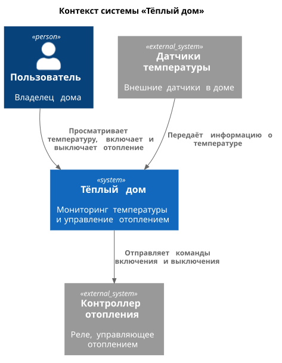
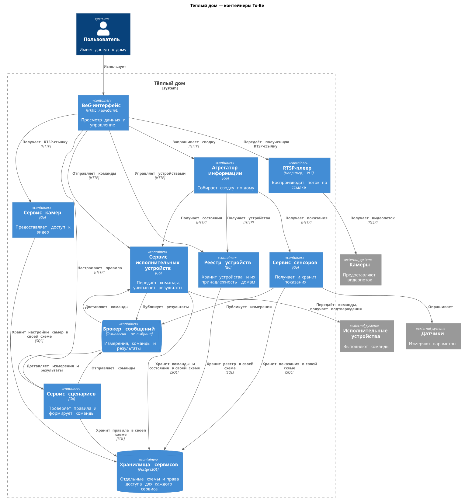
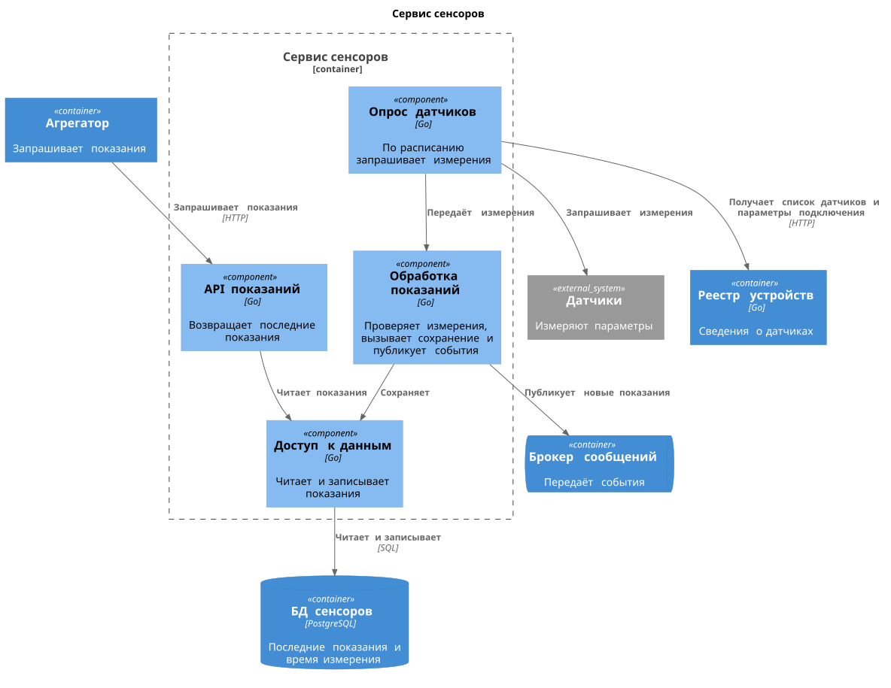
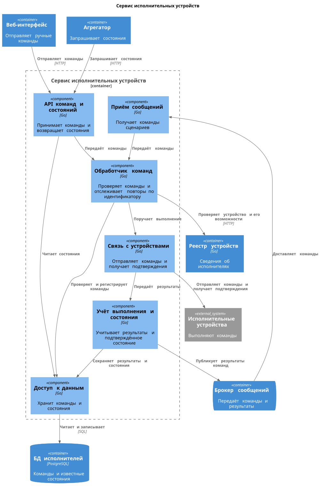
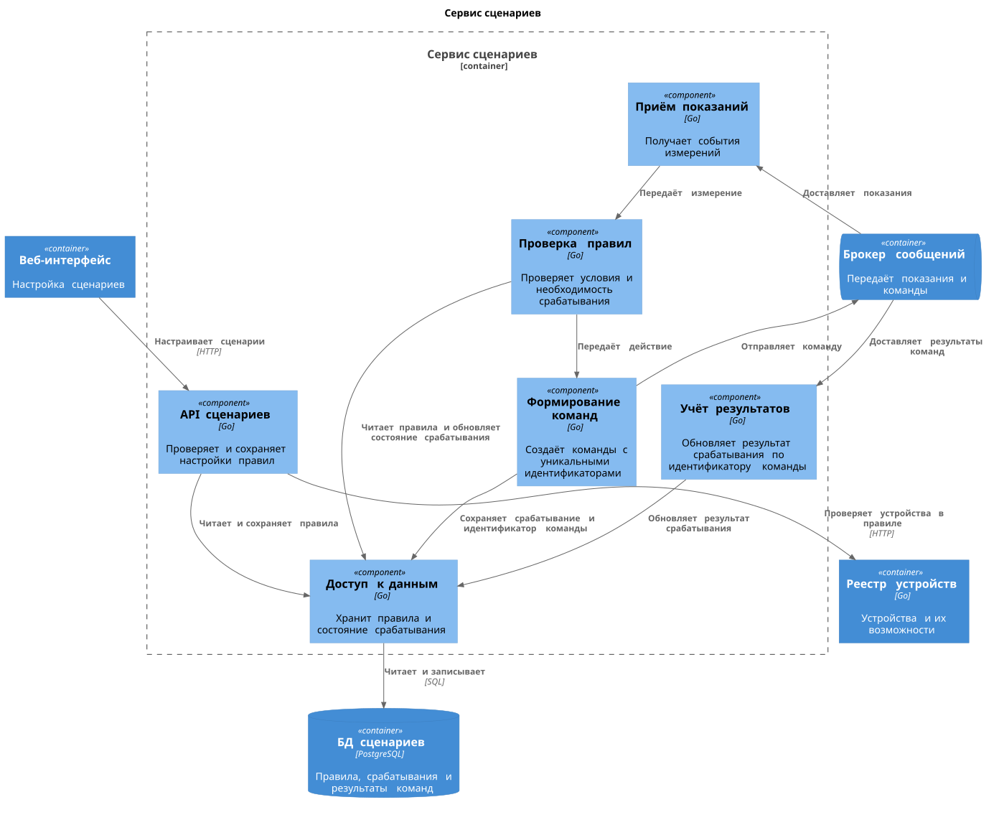
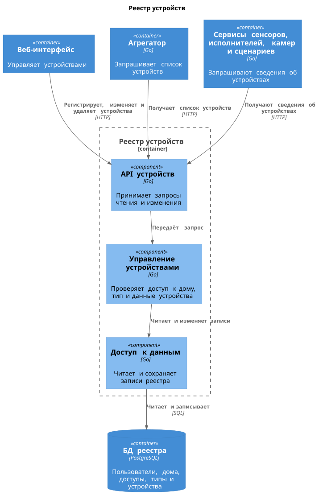
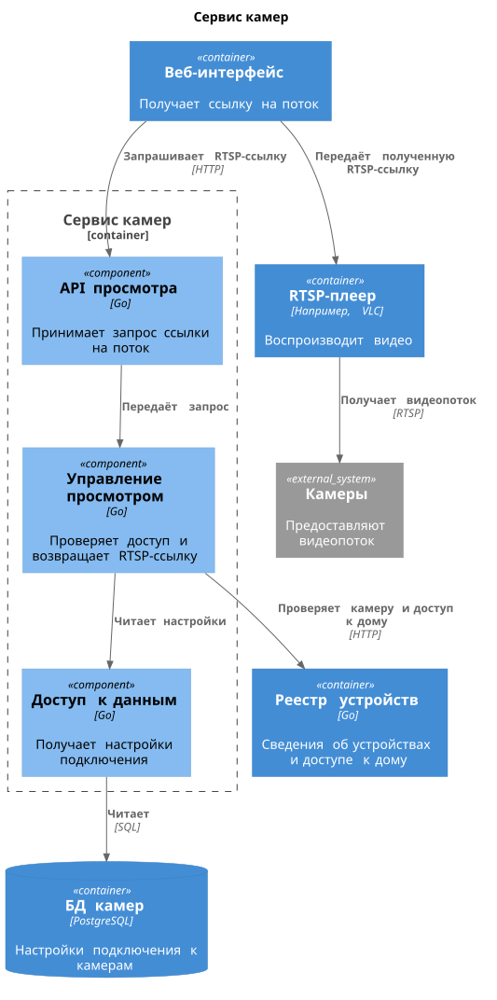
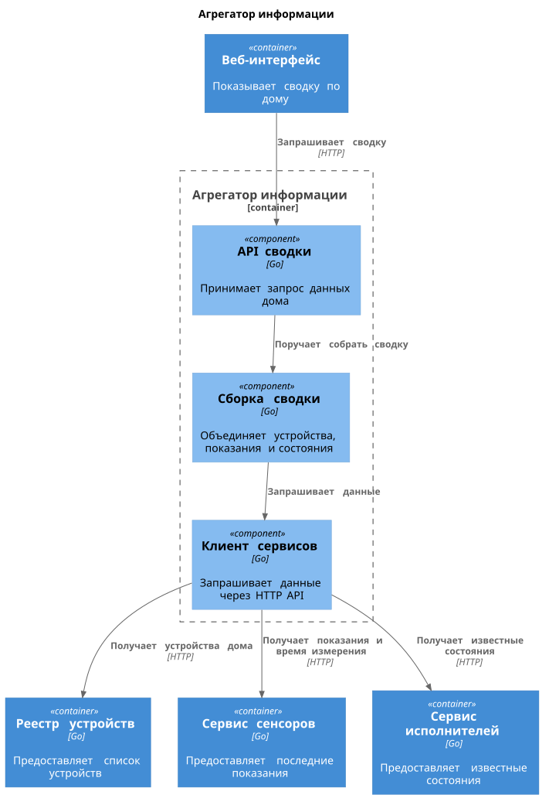
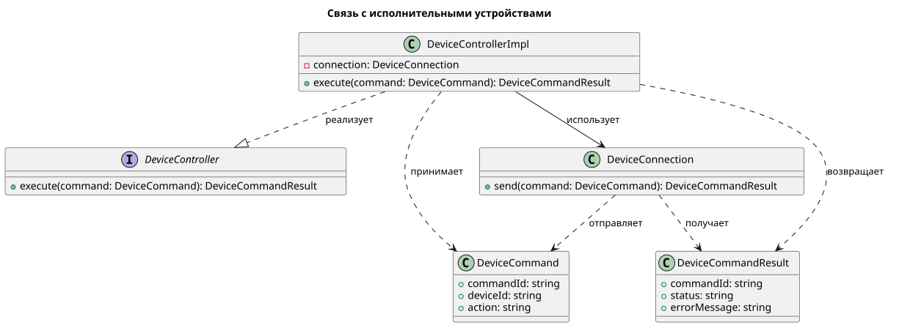
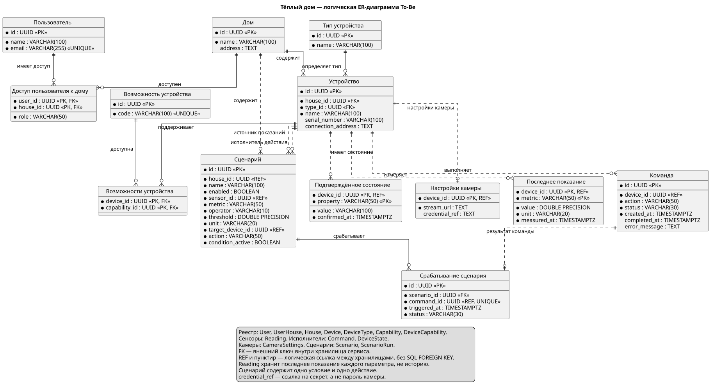

# Project_template

# Задание 1. Анализ и планирование

## 1. Описание функциональности монолитного приложения

- Отопление (нет в коде, есть в описании)
	- Включение отопления в доме
	- Выключение отопления в доме
- Мониторинг температуры
	- Получение текущей температуры из API
	- Получение текущей температуры по датчику
	- Просмотр температуры через веб (в описании есть)
- Управление датчиками
	- Создание записей о датчике
	- Просмотр списка датчиков
	- Просмотр информации о датчике
	- Изменение данных о датчике
	- Обновление значения и статуса датчика
	- Удаление датчика

## 2. Анализ архитектуры монолитного приложения

Язык — Go. База данных — PostgreSQL.

Приложение является монолитным, хотя компоненты разделены по пакетам в коде. Взаимодействие с БД и внешним API температуры синхронное: приложение отправляет запрос и ждёт ответа.

Хотя это монолит, домены хорошо видны: управление датчиками и мониторинг температуры. Отопление есть в описании, но в коде его нет.

Дописывать функционал можно, но увеличить количество экземпляров только одной части не получится. Придётся масштабировать всё приложение.

## 3. Домены и границы контекстов As-Is

**Управление датчиками**

Домен занимается добавлением и изменением датчиков в системе.

**Управление отоплением**

Домен занимается управлением отоплением.

**Мониторинг температуры**

Домен занимается связью с датчиками температуры,
получением запроса на температуру и выдачей результатов.

| Контекст               | За что отвечает                                   | Основные понятия                                                                     | Где заканчивается ответственность                                           |
| ---------------------- | ------------------------------------------------- | ------------------------------------------------------------------------------------ | --------------------------------------------------------------------------- |
| Учёт датчиков          | Добавление, изменение и удаление датчиков         | Датчик, идентификатор, тип, расположение                                             | Не получает показания и не включает отопление                               |
| Мониторинг температуры | Получение и предоставление текущих показаний      | Источник измерения, температура, единица измерения, время измерения                  | Не редактирует описание датчика и не управляет отоплением                   |
| Управление отоплением  | Включение и выключение отопления в выбранном доме | Отопительное устройство, команда, состояние «включено/выключено», идентификатор дома | Не регистрирует температурные датчики и не обслуживает просмотр температуры |

## 4. Проблемы монолитного решения

Очевидные минусы: нельзя увеличить количество экземпляров частей для горизонтального масштабирования. Обновление приложения останавливает весь функционал.

## 5. Диаграмма контекста C4

Исходники всех диаграмм находятся в папке `diagrams`.



# Задание 2. Проектирование микросервисной архитектуры

В задании 1 я выделил домены, которые вижу. Но если мы делаем задел на To-Be, то я предлагаю архитектуру, которая будет делить устройства не по доменам, типа отопления, камер и ворот, а на 3 типа устройств.

Брокер сообщений — для связки сценариев с сенсорами и управлением.

| Сервис / компонент                  | Ответственность                                                                                              | Взаимодействие                                                                                                                            |
| ----------------------------------- | ------------------------------------------------------------------------------------------------------------ | ----------------------------------------------------------------------------------------------------------------------------------------- |
| **Сервис сенсоров**                 | Получает показания датчиков, сохраняет их и предоставляет последнее известное значение со временем измерения | HTTP API для чтения показаний; публикует новые измерения в брокер                                                                         |
| **Сервис исполнительных устройств** | Передаёт команды устройствам, отслеживает выполнение и состояние                                             | HTTP API для ручного управления и чтения состояния; получает команды сценариев из брокера, публикует результаты                           |
| **Сервис камер**                    | Обеспечивает доступ к видеопотокам камер                                                                     | HTTP API для получения параметров просмотра; видео передаётся отдельным потоком                                                           |
| **Реестр устройств**                | Регистрирует, изменяет и удаляет устройства; хранит их тип, расположение и возможности                       | HTTP API для управления записями и получения сведений об устройствах                                                                      |
| **Сервис сценариев**                | Хранит правила автоматизации, проверяет условия и формирует команды                                          | HTTP API для настройки сценариев; получает измерения из брокера и отправляет через него команды                                           |
| **Агрегатор информации**            | Собирает сведения об устройствах, показаниях и состояниях для экрана пользователя                            | Принимает HTTP-запрос интерфейса и обращается к HTTP API нужных сервисов                                                                  |
| **Брокер сообщений**                | Передаёт события и команды между сервисами; сам не принимает решений об управлении                           | Сенсоры → сценарии: измерения. Сценарии → исполнительные устройства: команды. Исполнительные устройства → сценарии: результаты выполнения |

## Диаграмма контейнеров



## Диаграммы компонентов

### Сервис сенсоров



### Сервис исполнительных устройств



### Сервис сценариев



### Реестр устройств



### Сервис камер



### Агрегатор информации



## Диаграмма кода



# Задание 3. Разработка ER-диаграммы



# Задание 4. Создание и документирование API

## 1. Тип API

Для получения списка устройств, температуры, состояний и RTSP-ссылки используется REST API: клиент отправляет запрос и ожидает ответ. Команда включения или выключения тоже передаётся через REST, но ответ подтверждает только её принятие.

Для автоматизации используется брокер сообщений: сенсоры публикуют показания, сервис сценариев отправляет команды, сервис исполнителей публикует результаты.

## 2. Документация API

Пять выбранных REST-эндпоинтов описаны в [OpenAPI](api/openapi.yaml).

# Задание 5. Работа с Docker и Docker Compose

В `apps/temperature-api` находится приложение на Go. Оно возвращает случайную температуру от 18 до 28 °C на порту 8081:

- `/temperature?location=Living%20Room` — по расположению;
- `/temperature/1` — по идентификатору датчика, для вызовов из smart_home.

Приложение упаковано в `Dockerfile`. В `docker-compose.yml` добавлены temperature-api и настройки PostgreSQL. Скрипт `init.sql` подключён для инициализации пустой БД, данные сохраняются в томе.

Запуск из папки `apps`:

```bash
docker compose -p warmhouse up --build -d
```

В Postman-коллекции сначала выполнить `Create Sensor`, затем несколько раз `Get All Sensors`. При создании значение равно 0, при чтении подставляется случайная температура из temperature-api.

[Подробности запуска](apps/README.md).
